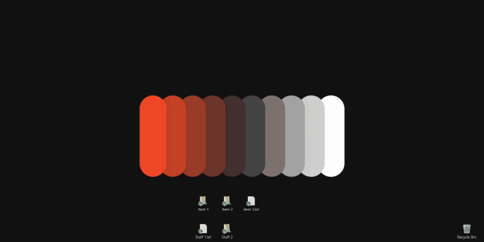
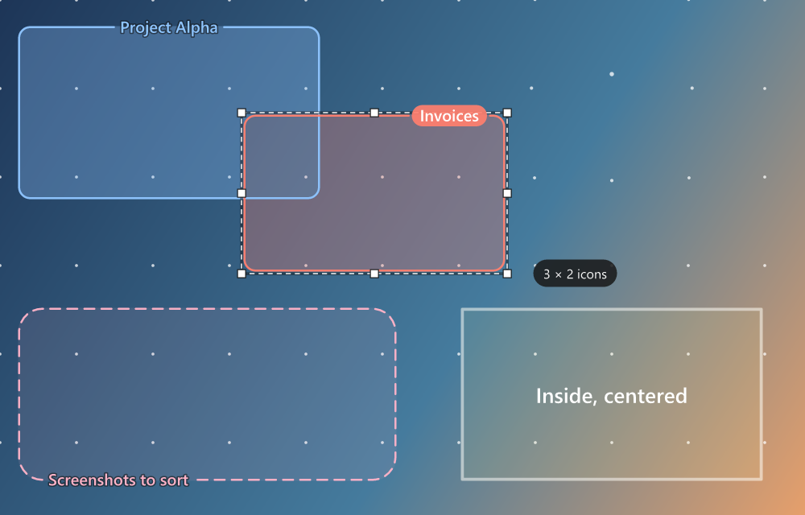

<p align="center">
  
</p>

<h1 align="center">DeskChalk</h1>

<p align="center">
  Draw labeled boxes on your desktop wallpaper, behind your icons.<br>
  A tiny tray app for sorting desktop chaos.
</p>

<p align="center">
  <a href="https://github.com/WuzNab/DeskChalk/releases"></a>
  <a href="https://ko-fi.com/wuznab"></a>
</p>

<p align="center">
  
</p>

---

You dump files on your desktop while you work. Folders are too slow. DeskChalk lets you
draw labeled zones on the desktop background, on the fly, and drag icons into them.

- **Boxes are just drawings.** They never hold, move, or touch your files. Icons stay normal desktop icons.
- **Behind your icons.** Boxes live between the wallpaper and the icons, so everything still clicks and drags as usual.
  (On Linux they're painted into the wallpaper itself; see [Linux](#linux).)
- **Snaps to the icon grid.** A dot grid matches your desktop icon spacing, so a box holds exactly *n × m* icons. Free-form works too.
- **Titles on the line.** Titles sit in a gap on the box's border by default, so icons never cover them. Six positions on the line, nine inside.
- **Colors mix.** Where boxes overlap, their colors blend (blue and red make purple) without getting darker.
- **Make it yours.** Box color and background opacity, border color, opacity, width and style, corner roundness, title font, size and style, and dot color, size and opacity.
- **Playful dots.** Grid dots drift away from the mouse (turn it off in the tray menu if you'd rather they stay put).
- **Per monitor.** Each box belongs to the screen you drew it on and stays there, even after resolution or scaling changes.
- **Lightweight.** A ~1 MB app that uses almost no memory or CPU while idle. No background services, no hooks.
- **Windows and Linux.** Windows 10/11, and Linux desktops on X11 or Wayland.

<p align="center">
  
</p>

## Install

Every [release](https://github.com/WuzNab/DeskChalk/releases) (the newest is at the top) has these downloads:

| Download | For |
| --- | --- |
| **DeskChalk_Setup_Windows_v*x.y.z*.exe** | Windows: the setup wizard (recommended) |
| **DeskChalk_Portable_Windows_v*x.y.z*.exe** | Windows: runs from anywhere, nothing installed |
| **DeskChalk_Setup_Linux_v*x.y.z*.deb** | Linux: Ubuntu, Debian, Mint, Pop!_OS and other Debian-based systems |
| **DeskChalk_Portable_Linux_v*x.y.z*.tar.gz** | Linux: any distribution, nothing installed |

### Windows

1. Download **DeskChalk_Setup_Windows_v*x.y.z*.exe**.
2. Run it and follow the wizard. No admin rights needed; it installs just for you. You can choose to:
   - start DeskChalk when Windows starts (on by default)
   - add it to the Start menu
   - create a desktop shortcut
3. Find the pencil icon in your tray (on Windows 11 it may be under the **^** overflow; drag it onto the taskbar to keep it visible).

Closed DeskChalk? Start it again from the Start menu or the desktop shortcut. If it's already running, opening it
shows its menu right where you clicked.

DeskChalk isn't code-signed yet, so Windows SmartScreen may say *"Windows protected your PC"*.
Click **More info**, then **Run anyway**.

**Updating:** run the newer `DeskChalk_Setup_Windows_v….exe`. It closes DeskChalk, updates it in place and keeps your boxes.
Choose **Clean reinstall** on the first page if you'd rather start fresh (this deletes all boxes and settings).

**Portable:** prefer not to install? Download **DeskChalk_Portable_Windows_v*x.y.z*.exe** and run it from anywhere.

### Linux

1. Download **DeskChalk_Setup_Linux_v*x.y.z*.deb** and open it (your software center installs it), or run
   `sudo apt install ./DeskChalk_Setup_Linux_v*x.y.z*.deb`.
2. Start **DeskChalk** from your applications menu. It starts at login from then on (turn that off in the tray menu).
3. Click the pencil in the system tray to draw.

Not on a Debian-based system? Download **DeskChalk_Portable_Linux_v*x.y.z*.tar.gz**, unpack it and run `deskchalk`.

## Use it

**Double-click the tray icon** (or press **Ctrl+Alt+D**) to start drawing. Your windows minimize, a dot grid appears, and you can:

| Do this | To |
| --- | --- |
| Drag on empty space | Draw a box (you'll be asked for a title) |
| Drag a box / its edges | Move / resize it |
| Double-click a box, or **F2** | Rename it |
| Right-click a box | Color, background opacity, border, border color and opacity, corner roundness, title position, size and style, duplicate, delete |
| Hold **Alt** while dragging | Toggle snapping (free-form or grid) |
| **Arrow keys** | Nudge the selected box (one icon slot; in free-form 1 px, or 10 px with Shift) |
| **Ctrl+Z** / **Ctrl+Y** | Undo / redo |
| **Ctrl+D** / **Del** | Duplicate / delete the selected box |
| **Esc** | Done; your windows come back |

Then drag your icons into the boxes like you normally would.

Everything else lives in the **tray menu**: show or hide boxes, color mixing, grid view (dots on the desktop), dot color, size, opacity
and the dots-move-away-from-the-mouse effect, the default style for new boxes, title font, desktop icon size, auto arrange and
align to grid, start with Windows, and uninstall. Menus stay open while you change settings, so you can adjust several in a row.

> **Tip:** turn **off** *Auto arrange icons* (DeskChalk offers to do this the first time, or use
> *Desktop icons* in the tray menu). Otherwise Windows pulls your icons back into a column.
> Leaving *Align icons to grid* on keeps icons neatly inside snapped boxes.

## Linux

Linux desktops have no layer between the wallpaper and the icons that other apps can draw in, so DeskChalk
shows a **copy of your wallpaper with the boxes painted on**. They sit behind your icons on X11 and Wayland
alike. Your own picture is never changed: DeskChalk remembers it and switches back to it when you exit or
uninstall. Pick a new wallpaper any time; DeskChalk notices and paints the boxes onto that one.

- **Supported desktops:** GNOME and Ubuntu, KDE Plasma, Xfce, Cinnamon (Linux Mint), MATE and Budgie, on any
  distribution. Elsewhere DeskChalk says so and leaves your wallpaper alone.
- **Your wallpaper is safe:** if DeskChalk can't read the wallpaper setting or the picture, it doesn't paint at
  all and tells you why. PNG, JPEG and WebP always work; other formats (JPEG XL, SVG, ...) work through the
  desktop's own image tools when they're installed.
- **Tray icon:** most desktops show it. Stock GNOME (e.g. Fedora) needs the
  [AppIndicator extension](https://extensions.gnome.org/extension/615/appindicator-support/); without a tray,
  open DeskChalk again from the applications menu to draw.
- **Drawing:** click the tray icon. Your wallpaper fills the screen (icons hide until you're done). Drawing works
  as on Windows, except that **Shift** toggles snapping while dragging (Alt-drag moves windows on Linux).
  Right-click a box for its style, or empty space for undo, redo and grid options.
- **The grid follows your desktop icons** by itself: DeskChalk reads the icon layout of GNOME and Ubuntu
  (Desktop Icons NG), Cinnamon (Nemo), Xfce and KDE Plasma, including icon size, panels and the dock, and
  keeps up when they change. Without desktop icons it uses an even grid (tray menu → *Grid dots* → *Spacing*).
  Dots move away from the mouse while you draw; in the wallpaper they hold still.
- **Exit** from the tray menu puts your original wallpaper back.

## Uninstall

**Windows:** tray menu → **Uninstall DeskChalk…**, **Settings → Apps → Installed apps → DeskChalk**, or
**Control Panel → Programs and Features**. This removes the app, its shortcuts, its startup entry, and your boxes
and settings. Nothing is left behind, and your desktop icons are not touched.

The portable version: tray menu → **Remove DeskChalk (portable)…** deletes its boxes, settings and startup entry;
then delete the portable exe yourself.

**Linux:** tray menu → **Uninstall DeskChalk…** switches back to your own wallpaper, deletes your boxes and settings and removes
the package (it asks for your password). Removing the package another way leaves the painted wallpaper in place, so
use the tray menu, or run `deskchalk --quit` first. The portable version: tray menu → **Remove DeskChalk (portable)…**,
then delete the folder.

## Requirements

- **Windows** 10 or 11, 64-bit. Developed and tested on Windows 11 25H2; the Windows 10 code path is implemented but less tested.
- **Linux** 64-bit (x86-64) with glibc 2.35 or newer (Ubuntu 22.04, Debian 12, Fedora 36, Mint 21 and later), on one of
  the desktops listed under [Linux](#linux). `zenity` or `kdialog` (usually installed) adds the custom color picker.

## Troubleshooting

- **Boxes don't show up:** tray menu → *Desktop icons* → **Refresh desktop layer**.
- **Something looks off:** run `DeskChalk.exe --diag` (Linux: `deskchalk --diag`) from a terminal and include the
  output in an issue. Start with `--log` to write a log to `%APPDATA%\DeskChalk\deskchalk.log`
  (Linux: `~/.config/deskchalk/deskchalk.log`).
- **Not in Settings → Apps after installing:** start DeskChalk once from the Start menu; it puts its entry back.
  (This happens when the setup was started from inside another app, such as a packaged app's terminal or
  download list: Windows then keeps the setup's registry changes private to that app.)
- **Restarting Explorer:** DeskChalk reattaches by itself within a couple of seconds. Restart Explorer from
  Task Manager (*Windows Explorer → Restart*) rather than killing `explorer.exe`; a hard kill can lose your icon positions.
- **Settings file:** `%APPDATA%\DeskChalk\config.json` (Linux: `~/.config/deskchalk/config.json`), per user. If it
  ever becomes unreadable, DeskChalk keeps a copy as `config.broken.json` and starts fresh.

<details>
<summary>Command-line options</summary>

| Option | Effect |
| --- | --- |
| `--edit` | Start in drawing mode (or switch the running DeskChalk into it) |
| `--quit` | Close the running DeskChalk |
| `--diag` | Print what DeskChalk detects (desktop windows or wallpaper settings, monitors, icon grid) |
| `--log` | Write a log file |

The Windows setup supports the usual Inno Setup switches, e.g. `DeskChalk_Setup_Windows_v0.3.0.exe /SILENT` for an
unattended install.

</details>

## Build from source

Install [Rust](https://rustup.rs) (on Windows the MSVC toolchain; Visual Studio Build Tools provide the linker), then:

```
cargo build --release
```

The app is `target/release/DeskChalk` (`DeskChalk.exe` on Windows) and runs from there without installing.

- **Windows setup wizard:** install [Inno Setup 6](https://jrsoftware.org/isinfo.php) and run
  `iscc /DAppVersion=0.3.0 installer\DeskChalk.iss`.
- **Linux packages:** `sh packaging/linux/build.sh 0.3.0` (needs `dpkg-deb`; `rsvg-convert` adds PNG icons).

Push a `v*` tag to have GitHub Actions build everything and publish a release.

## Support

DeskChalk is free. If it tidies up your desktop, you can [buy me a coffee on Ko-fi](https://ko-fi.com/wuznab) ☕

## License

[PolyForm Strict 1.0.0](LICENSE.txt): free for personal and other noncommercial use. Redistributing DeskChalk
or publishing modified versions isn't permitted.

The icon is based on [Material Design Icons](https://pictogrammers.com/library/mdi/icon/draw/) "draw"
(Apache License 2.0).
